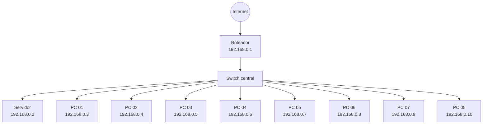
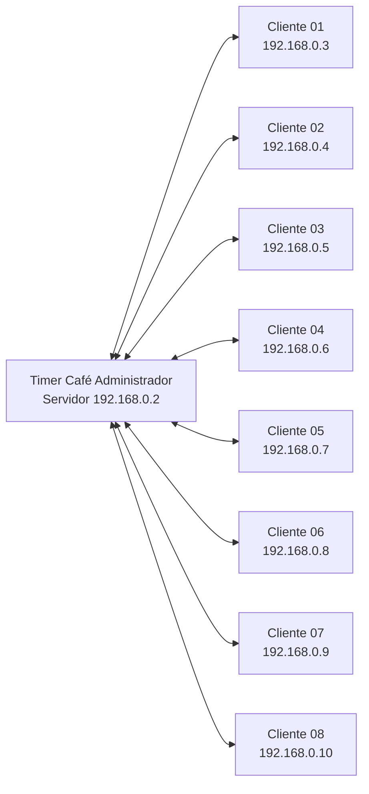

# 🎮 OVERCLOCK-ARENA | LAN HOUSE CASEIRA

<p align="center">
  <strong>Projeto de Infraestrutura de Redes e Montagem de uma LAN House</strong>
</p>

<p align="center">
  🖥️ 8 Computadores Clientes | 🗄️ 1 Servidor | 🌐 Rede Local
</p>

---

## 📌 Sobre o projeto

O **Overclock-Fight** é um projeto acadêmico de montagem e configuração de uma LAN house caseira. A infraestrutura utiliza equipamentos físicos para implementar uma rede local composta por **8 computadores clientes**, **1 servidor**, **1 roteador** e um **switch central**.

O projeto demonstra, na prática, conceitos de infraestrutura de TI, montagem de computadores, endereçamento IPv4, compartilhamento de recursos, administração de sistemas e diagnóstico de rede.

## 📑 Sumário

- [Objetivos](#-objetivos)
- [Estrutura da LAN house](#%EF%B8%8F-estrutura-da-lan-house)
- [Topologia da rede](#-topologia-da-rede)
- [Plano de endereçamento IPv4](#-plano-de-endereçamento-ipv4)
- [Configuração de IP fixo no Windows 11](#%EF%B8%8F-configuração-de-ip-fixo-no-windows-11)
- [Instalação do Timer Café](#%EF%B8%8F-instalação-do-timer-café)
- [Testes de conectividade](#-testes-de-conectividade)
- [Segurança](#-segurança)
- [Aplicativos utilizados](#-aplicativos-utilizados)
- [Organização dos grupos](#-organização-dos-grupos)
- [Checklist final](#-checklist-final)

---

## 🎯 Objetivos

- Desenvolver uma infraestrutura de rede local funcional.
- Configurar a comunicação entre os computadores.
- Implementar um servidor para gerenciamento da LAN house.
- Realizar testes de conectividade.
- Aplicar conceitos de hardware e redes de computadores.
- Documentar todas as etapas de desenvolvimento.

---

## 🖥️ Estrutura da LAN house


| Equipamento | Quantidade | Função |
|---|---:|---|
| Computadores clientes | 8 | Acesso dos usuários e execução dos jogos |
| Servidor | 1 | Administração e gerenciamento das estações |
| Switch | 1 | Interligação cabeada dos equipamentos |
| Roteador | 1 | Gateway, DNS e acesso à internet |
| Cabos Ethernet | Conforme a montagem | Comunicação entre os equipamentos |

---

## 🌐 Topologia da rede


A rede utiliza uma topologia física em estrela. O roteador, o servidor e os oito computadores clientes são interligados pelo switch central.



> [!NOTE]
> O servidor e os clientes são ligados ao switch. Os clientes não devem ser conectados fisicamente através do servidor.

---

## 📋 Plano de endereçamento IPv4

| Equipamento | Endereço IP | Máscara | Gateway | DNS |
|---|---:|---:|---:|---:|
| Roteador | `192.168.0.1` | `255.255.255.0` | — | Conforme a operadora |
| Servidor | `192.168.0.2` | `255.255.255.0` | `192.168.0.1` | `192.168.0.1` |
| PC Cliente 01 | `192.168.0.3` | `255.255.255.0` | `192.168.0.1` | `192.168.0.1` |
| PC Cliente 02 | `192.168.0.4` | `255.255.255.0` | `192.168.0.1` | `192.168.0.1` |
| PC Cliente 03 | `192.168.0.5` | `255.255.255.0` | `192.168.0.1` | `192.168.0.1` |
| PC Cliente 04 | `192.168.0.6` | `255.255.255.0` | `192.168.0.1` | `192.168.0.1` |
| PC Cliente 05 | `192.168.0.7` | `255.255.255.0` | `192.168.0.1` | `192.168.0.1` |
| PC Cliente 06 | `192.168.0.8` | `255.255.255.0` | `192.168.0.1` | `192.168.0.1` |
| PC Cliente 07 | `192.168.0.9` | `255.255.255.0` | `192.168.0.1` | `192.168.0.1` |
| PC Cliente 08 | `192.168.0.10` | `255.255.255.0` | `192.168.0.1` | `192.168.0.1` |

> [!IMPORTANT]
> Cada equipamento deve possuir um endereço IP diferente. Os endereços de `192.168.0.2` até `192.168.0.10` devem ser reservados no roteador ou mantidos fora da faixa DHCP para evitar conflitos.

---

## ⚙️ Configuração de IP fixo no Windows 11

### 1. Abrir as conexões de rede

1. Pressione `Windows + R`.
2. Digite:

```text
ncpa.cpl
```

3. Pressione `Enter`.

### 2. Abrir as propriedades da conexão

1. Localize a conexão **Ethernet**.
2. Clique com o botão direito em **Ethernet**.
3. Selecione **Propriedades**.

### 3. Definir o protocolo usado no projeto

1. Localize **Protocolo IP Versão 6 (TCP/IPv6)**.
2. Para seguir a configuração adotada neste projeto, desmarque essa opção.
3. Selecione **Protocolo IP Versão 4 (TCP/IPv4)**.
4. Clique em **Propriedades**.

> [!CAUTION]
> A desativação do IPv6 não é necessária em todas as redes. Este procedimento deve ser aplicado somente se fizer parte da configuração definida para o laboratório.

### 4. Configurar o IPv4

Marque **Usar o seguinte endereço IP** e informe o endereço reservado para o computador.

Exemplo do **PC Cliente 01**:

```text
Endereço IP:         192.168.0.3
Máscara de sub-rede: 255.255.255.0
Gateway padrão:      192.168.0.1
```

### 5. Configurar o DNS

Marque **Usar os seguintes endereços de servidor DNS**:

```text
Servidor DNS preferencial: 192.168.0.1
Servidor DNS alternativo:  deixar em branco
```

### 6. Salvar

1. Clique em **OK**.
2. Clique novamente em **OK** ou **Fechar**.
3. Repita o procedimento nos demais computadores, alterando apenas o endereço IP conforme a tabela.

---

## ⏱️ Instalação do Timer Café

O Timer Café será dividido em dois módulos:

- **Administrador:** instalado no servidor `192.168.0.2`.
- **Cliente:** instalado nos oito computadores, de `192.168.0.3` até `192.168.0.10`.

### 1. Download

Acesse o site do fabricante:

- [Timer Café — FAD Softwares](https://www.fad-softwares.com.br/)

> [!WARNING]
> Utilize somente o instalador obtido no site do fabricante. Confira a versão disponível e as instruções apresentadas pelo instalador antes de prosseguir.

### 2. Instalar o módulo Administrador no servidor

1. Entre no Windows do servidor com uma conta de administrador.
2. Execute o instalador do Timer Café.
3. Selecione o módulo de administração ou servidor oferecido pelo instalador.
4. Conclua a instalação.
5. Reinicie o servidor se o instalador solicitar.
6. Abra o módulo Administrador e faça a configuração inicial disponível na versão instalada.

Configuração de rede do servidor:

```text
Endereço IP: 192.168.0.2
Gateway:     192.168.0.1
DNS:         192.168.0.1
```

### 3. Instalar o módulo Cliente

Repita este procedimento em cada um dos oito computadores:

1. Entre no Windows com uma conta de administrador.
2. Execute o instalador.
3. Selecione o módulo cliente apresentado pelo instalador.
4. Conclua a instalação.
5. Reinicie o computador se solicitado.
6. Quando o módulo cliente pedir o endereço do servidor, informe:

```text
192.168.0.2
```

> [!NOTE]
> Os nomes dos módulos, menus e campos podem variar conforme a versão do Timer Café. Use os nomes exibidos pelo instalador e consulte a documentação fornecida pelo fabricante.

### 4. Permitir a comunicação no Firewall do Windows

No servidor e nos clientes:

1. Abra **Segurança do Windows**.
2. Entre em **Firewall e proteção de rede**.
3. Clique em **Permitir um aplicativo pelo firewall**.
4. Autorize somente os executáveis instalados pelo Timer Café na rede **Privada**.
5. Não desative completamente o firewall.

### 5. Testar antes de liberar para uso

1. Confirme que o servidor está ligado e conectado ao switch.
2. Confirme que o cliente consegue alcançar `192.168.0.2`.
3. Abra o módulo Administrador.
4. Verifique se a estação aparece conectada.
5. Inicie uma sessão de teste.
6. Encerre a sessão e confira o registro no servidor.
7. Repita nos oito clientes.

### Diagrama de comunicação



### Imagem ilustrativa da instalação

Adicione a imagem gerada à pasta `imagens` com o nome `instalacao-timer-cafe.png` e use:

```markdown

```

> A imagem é conceitual. As telas reais podem variar conforme a versão instalada.

---

## 🧪 Testes de conectividade


Abra o **Prompt de Comando**.

### Conferir o endereço IP

```bat
ipconfig /all
```

### Testar o roteador

```bat
ping 192.168.0.1
```

### Testar o servidor a partir de um cliente

```bat
ping 192.168.0.2
```

### Testar o Cliente 01 a partir do servidor

```bat
ping 192.168.0.3
```

Uma resposta semelhante à seguinte indica alcance IP:

```text
Resposta de 192.168.0.2: bytes=32 tempo<1ms TTL=128
```

> [!NOTE]
> O `ping` confirma o alcance entre os equipamentos, mas não garante sozinho que o Timer Café esteja conectado. A confirmação final deve ser feita no painel Administrador e com uma sessão de teste.

---

## 🔐 Segurança

- Utilizar senhas diferentes para as contas administrativas.
- Manter o Windows 11 e os aplicativos atualizados.
- Manter o Firewall do Windows ativado.
- Autorizar no firewall somente os programas necessários.
- Reservar os endereços fixos no roteador.
- Não compartilhar senhas, tokens ou credenciais no GitHub.
- Fazer backup periódico das configurações e da documentação.

---

## 📚 Conhecimentos aplicados

- Hardware e montagem de computadores.
- Redes de computadores.
- Infraestrutura de TI.
- Sistemas operacionais.
- Administração de servidores.
- Cabeamento de rede.
- Diagnóstico e resolução de problemas.
- Documentação técnica com Markdown e GitHub.

---

## 💻 Aplicativos utilizados

- [Urban Terror](https://www.urbanterror.info/home/)
- [Timer Café](https://www.fad-softwares.com.br/)
- [Driver Booster](https://www.iobit.com/pt/driver-booster.php)

> [!CAUTION]
> Antes de instalar ferramentas de atualização de drivers, crie um ponto de restauração. Para placas de vídeo e chipsets, dê preferência aos sites oficiais da NVIDIA, AMD, Intel e do fabricante da placa-mãe.

---

## 👥 Organização dos grupos

O projeto **OVERCLOCK-FIGHT** foi dividido em quatro grupos de trabalho para distribuir responsabilidades e facilitar o desenvolvimento da LAN house.

| Grupo | Integrantes |
|---|---|
| Grupo 1 | Gabriel, Rafaela, Jamile, Milena e Gabriela |
| Grupo 2 | Reinaldo, Gustavo, Ricardo, Jhonatan e Miguel |
| Grupo 3 | Jhonatan, Eduardo, Mhateus, Victor e Felipe Dodo |
| Grupo 4 | Giovanna, Vinicius, Lucas e Felipe Bispo |

---

## ✅ Checklist final

### Rede

- [ ] Roteador configurado como `192.168.0.1`
- [ ] Servidor configurado como `192.168.0.2`
- [ ] Clientes configurados de `192.168.0.3` até `192.168.0.10`
- [ ] Máscara configurada como `255.255.255.0`
- [ ] Gateway configurado como `192.168.0.1`
- [ ] DNS preferencial configurado como `192.168.0.1`
- [ ] Endereços fixos reservados ou fora da faixa DHCP
- [ ] Todos os computadores respondem ao roteador
- [ ] Todos os clientes conseguem alcançar o servidor

### Timer Café

- [ ] Módulo Administrador instalado no servidor
- [ ] Módulo Cliente instalado nos oito computadores
- [ ] Clientes configurados para localizar `192.168.0.2`
- [ ] Regras necessárias criadas no Firewall do Windows
- [ ] Oito estações visíveis no painel Administrador
- [ ] Sessão de teste iniciada e encerrada em cada estação

---

<p align="center">
  <strong>OVERCLOCK-FIGHT</strong><br>
  Projeto acadêmico de infraestrutura de redes.
</p>
